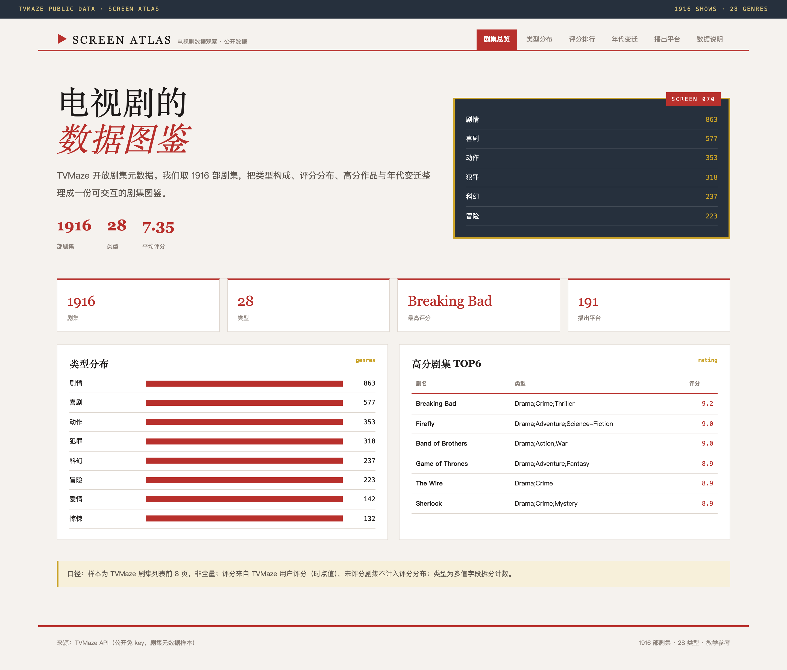
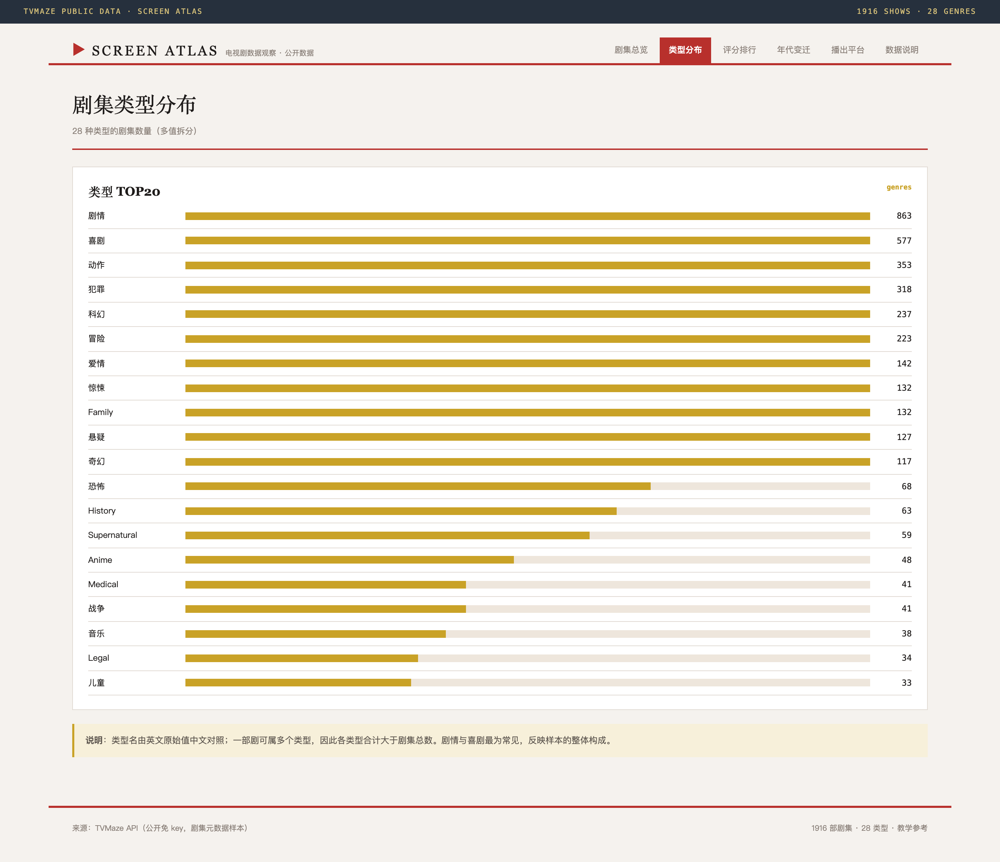
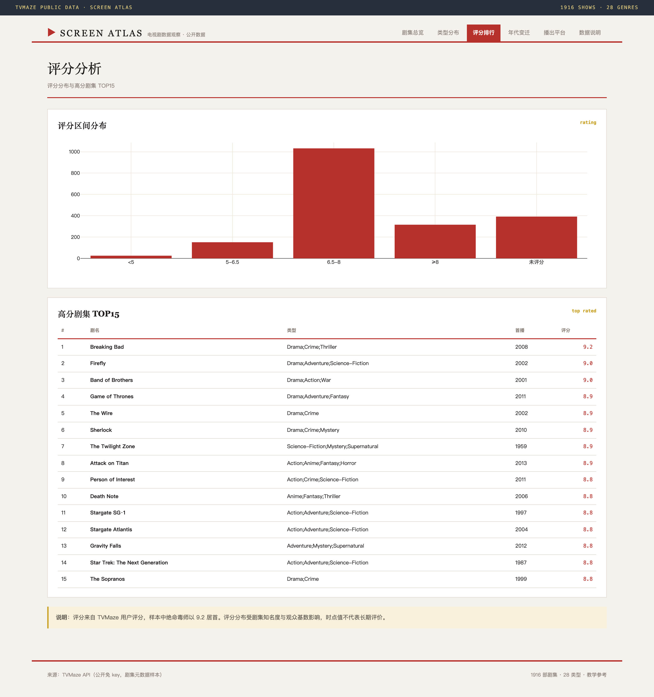
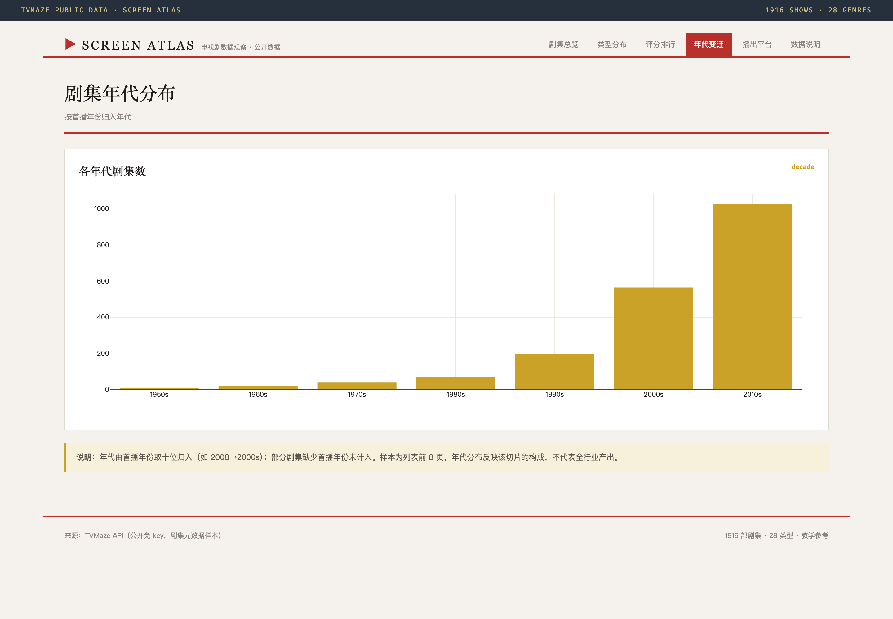
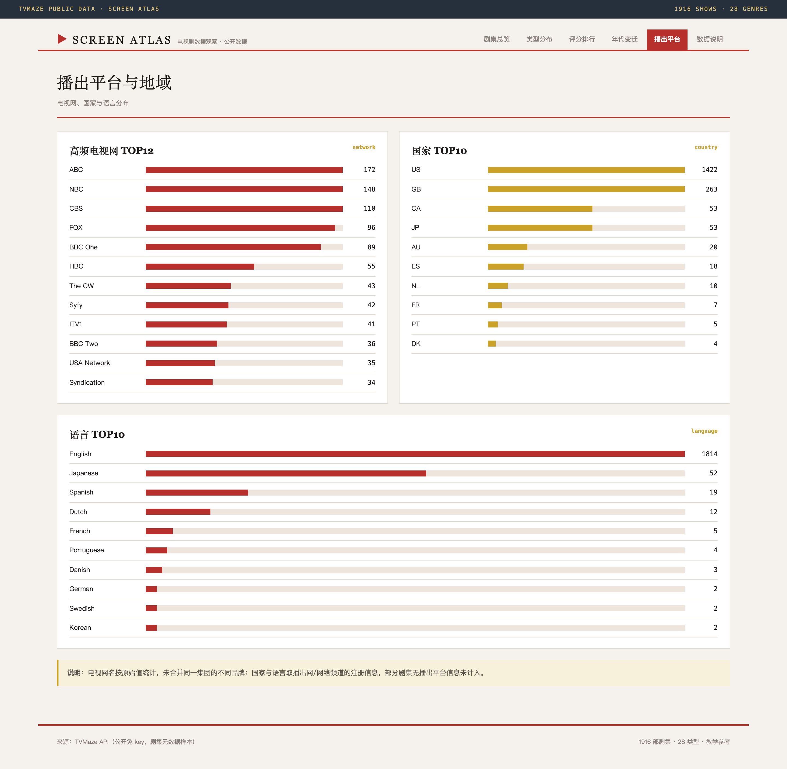
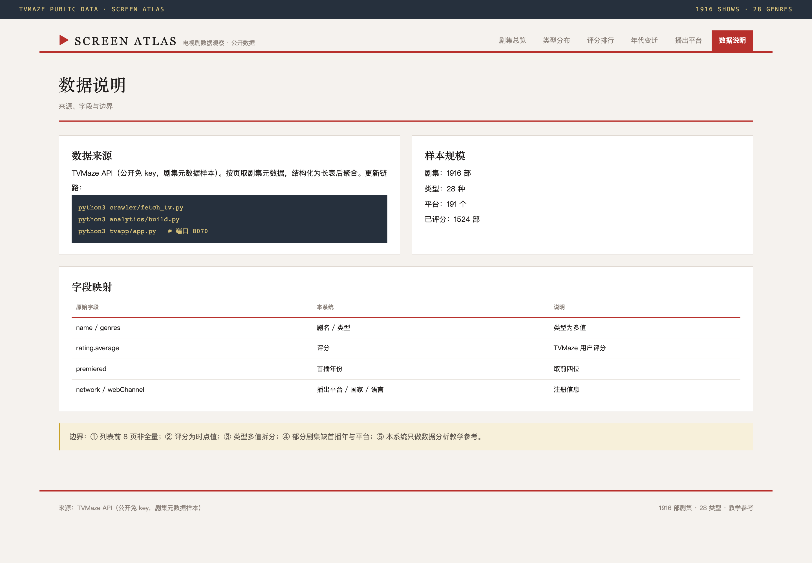

# 070 基于TVMaze公开数据的电视剧数据分析系统-设计展示

> **代码有偿获取 可接受定制 微信联系方式: csbysj2020 或 ACE2487，备注(BS)**

> **完整源码与全套文档 · 在线自助获取 >>> [https://mbd.pub/o/bread/YZaWmJptaw==](https://mbd.pub/o/bread/YZaWmJptaw==)**

> **成品页（功能介绍 / 更多选题）>>> [https://bishe.suilang.net/products/screen-atlas](https://bishe.suilang.net/products/screen-atlas)**

> 

> 

## 视频

> **点击查看 >>> [https://www.bilibili.com/video/BV158ytzaEeY/](https://www.bilibili.com/video/BV158ytzaEeY/)**

## 项目简介

影视图鉴风格（深红、金色、电影海报卡片），区别于警务档案/人口时钟/台账/街机。采集 TVMaze 公开剧集 1916 部、28 种类型，从类型、评分、年代与播出平台四维分析。Flask + Plotly.js（本地化离线可用），6 个页面。列表切片与评分时点口径如实标注，不做作品质量评价。

电视剧元数据是观察影视内容供给的窗口。

本项目设计并实现了一套基于 TVMaze 公开数据的电视剧分析系统：通过 API 分页获取 1916 部剧集元数据，结构化后从类型构成、评分分布、高分作品、年代变迁与播出平台五个维度聚合分析。

系统采用 Flask + Plotly.js 与影视图鉴式界面（深红、金色、电影海报卡片），实现剧集总览、类型分布、评分排行、年代变迁、播出平台、数据说明 6 个页面。

本仓库为**设计展示**：包含项目说明、技术架构、实验结果与运行截图；完整源码、任务书、开题报告、毕业论文与使用说明可通过上方链接自助获取，成品页可查看更多选题，也可联系微信咨询定制。

## 功能特性

1. 差异化视觉：影视图鉴（深红/金色/海报卡片），非看板/画廊/档案/时钟

2. 真实采集：TVMaze API 公开免 key，1916 部剧集

3. 四维分析：类型/评分分布/高分作品/年代/平台

4. 类型中文对照：28 种类型英文原始值对照

5. 评分排行：绝命毒师 9.2 居首，评分时点口径透明

6. 年代变迁：按首播年份归入年代

7. 技术栈差异化：Flask + Plotly.js（本地化）

8. 合规边界：列表切片非全量、评分时点值，不做质量评价

## 技术架构

| 项目 | 说明 |
| --- | --- |
| 编程语言 | Python 3.8+ |
| Web 框架 | Flask（轻量路由，无 ORM） |
| 图表 | Plotly.js（本地化离线可用） |
| 数据源 | TVMaze API（公开免 key） |
| 样本规模 | 1916 剧集 / 28 类型 |
| 运行端口 | http://127.0.0.1:8070 |
| 说明 | 数据直读 analysis JSON，无需数据库 |

## 目录结构

以下为完整交付版的结构（本仓库仅作设计展示）：

```
screen-atlas/
├── analytics/
│   └── build.py
├── crawler/
│   └── fetch_tv.py
├── data/
│   ├── analysis/
│   │   ├── countries.json
│   │   ├── decades.json
│   │   ├── genres.json
│   │   ├── languages.json
│   │   ├── networks.json
│   │   ├── rating_bins.json
│   │   ├── statuses.json
│   │   └── top_rated.json
│   ├── processed/
│   │   └── shows.csv
│   └── stats.json
├── static/
│   ├── css/
│   │   └── style.css
│   └── vendor/
│       └── plotly.min.js
├── templates/
│   ├── about.html
│   ├── base.html
│   ├── decades.html
│   ├── genres.html
│   ├── networks.html
│   ├── overview.html
│   └── ratings.html
├── tvapp/
│   └── app.py
├── 任务书/
│   └── 毕业设计任务书.docx
├── 开题报告/
│   └── 毕业设计开题报告.docx
├── 最终论文/
│   ├── 图/
│   │   └── fig-arch.png
│   └── 基于TVMaze公开数据的电视剧数据分析系统设计与实现.docx
├── 演示截图/
│   ├── 070-01-overview.png
│   └── …
└── …
```

## 数据与实验结论

- 实验显示剧情与喜剧为最常见类型，绝命毒师以 9.2 分居评分榜首。
- 真实采集：TVMaze API 公开免 key，1916 部剧集
- 类型中文对照：28 种类型英文原始值对照
- 评分排行：绝命毒师 9.2 居首，评分时点口径透明

## 交付内容

1. 完整源码（Flask 应用 + 采集器 + 分析引擎 + 6 页面）
2. 真实数据（shows.csv + analysis JSON）
3. 任务书与开题报告（Word）
4. 毕业论文（Word 七章制）
5. 二次开发说明（Word+md）
6. 6 张截图 + 封面 + 演示视频

## 常见问题

**是全量剧集吗？**

不是，列表前 8 页，页面与论文均说明。

**评分可靠吗？**

为 TVMaze 用户评分时点值，受观众基数影响，不宜作绝对评价。

**类型为什么合计大于总数？**

一部剧可属多个类型，拆分后各计一次，这是口径。

**图表能离线用吗？**

能，plotly.min.js 已本地化到 static/vendor/。

## 截图







